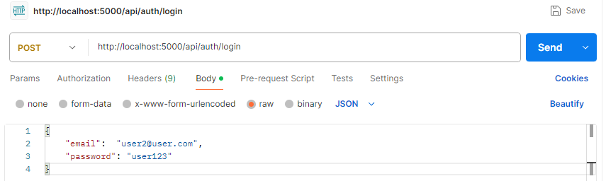

# Mon Petit Uber

Copie indépendante du repo privé

Avant de démarrer, copier `frontend/.env.example` vers `frontend/.env` pour choisir le backend de cette copie, puis copier `backend/.env.example` vers `backend/.env` et configurer de nouvelles valeurs pour la base de données, Brevo, Stripe, Google OAuth et les sessions. L’adresse d’expéditeur doit être configurée et autorisée dans Brevo. Les anciennes clés ne sont pas incluses dans cette copie. Les téléversements de profils et d’avis de l’ancienne application ne sont pas repris; leurs dossiers sont recréés vides.

La redirection vers l’ancien backend hébergé a été retirée. Pour un déploiement frontend séparé, définir `VITE_API_URL` avec l’adresse de ton nouveau backend avant de compiler.

Voir [la configuration des credentials](docs/Credentials.md). Aucun déploiement ni transfert de base de données n’a été effectué.

Application web moderne permettant de vendre des produits pour ramassage ou pour livraison au sein de l'école.
Il permet de gérer des utilisateurs, les employés, l'inventaire des produits, des promotions et de ventes.
Assure des paramètres de sécurité.

---

# 📚 Table des matières

* [🚀 Stack technique](#-stack-technique)
* [📁 Structure du projet](#-structure-du-projet)
* [⚙️ Installation](#️-installation)
* [▶️ Ouverture du projet (ProjectReact)](#️-ouverture-du-projet-projectreact)
* [🗄️ Visualiser la base de données](#️-visualiser-la-base-de-données)
* [🛠️ Ajout/modification des propriétés dans un modèle](#️-ajoutmodification-des-propriétés-dans-un-modèle)
* [🧪 Tests unitaires](#️-tests-unitaires)
* [🔌 API principale](#-api-principale)
* [📬 Utilisation de Postman](#-utilisation-de-postman-pour-tester-les-contrôleurs)
* [🔐 Double authentification](#-double-authentification)
* [🚀 Déploiement](#-déploiement)
* [👥 Contributeurs](#-contributeurs)

---

# 🚀 Stack technique

* React
* TypeScript
* Node.js
* PostgreSQL
* Prisma ORM
* JWT Authentication
* Express

---

# 📁 Structure du projet

```txt
Mon-Petit-Uber/
├── backend/
├── frontend/
└── setup.bat
└── README.md
├── docs/
│   ├── Stripe_Facturation.md
│   └── Twilio_2FA.md
│   └── Deploiement.md
```

---

# ⚙️ Installation

Utiliser la branche `main` de cette copie après avoir configuré les variables d’environnement.

Dans ce repo, il y a un fichier `setup.bat` permettant de :

* Installer les dépendances du backend
* Initialiser la base de données Prisma
* Créer les migrations Prisma
* Appliquer le seed Prisma
* Installer les dépendances du frontend

Double-clique sur le fichier `setup.bat` pour initialiser le projet.

---

# ▶️ Ouverture du projet (ProjectReact)

## Backend

Ouvrir un terminal :

```bash
cd backend
npm run start
```

Si tout fonctionne correctement :

```txt
http://localhost:5000/
```

---

## Frontend

Ouvrir un autre terminal :

```bash
cd frontend
npm run dev
```

Si tout fonctionne correctement :

```txt
http://localhost:5173/accueil
```

---

# 🗄️ Visualiser la base de données

```bash
npx prisma studio
```

---

# 🛠️ Ajout/modification des propriétés dans un modèle

Au lieu de créer une nouvelle migration, il est recommandé de réinitialiser les migrations :

```bash
npx prisma migrate reset
```

Ensuite, relancer le fichier `setup.bat`.

---

# 🧪 Tests unitaires

## Exécuter tous les tests

```bash
npm run test
```

---

## Vérifier la couverture de test

```bash
npx jest --coverage --ci --colors --coverageReporters="text"
```

---

## Tester un contrôleur spécifique

Exemple pour le contrôleur d’authentification :

```bash
npm run test src/controllers/auth.controller.ts
```

---

# 🔌 API principale

## Authentification

```txt
api/auth
POST    register
POST    login
POST    verifyEmail
POST    forgotEmail
POST    resetPassword
POST    logout
```

---

## Produits

```txt
api/products
GET     getAll
GET     getById/${id}
POST    create
PUT     update/${id}
DELETE  remove/${id}
```

---

## FAQ

```txt
api/faq
GET     getAll
GET     ${id}
POST    create
PUT     ${id}
DELETE  ${id}
```

---

## Catégories

```txt
api/category
GET     getAll
POST    create
PUT     ${updateCategory.id}
DELETE  ${id}
```

---

## Panier

```txt
api/cart
GET     getCart
POST    clear
POST    addToCart
GET     cartWithPromotions
POST    removeOne
DELETE  removeItem/${productId}
```

---

## Promotions

```txt
api/promotion
GET     getAll
POST    create
DELETE  ${promotionId}
PUT     ${promotionId}
GET     active
GET     product/${productId}
```

---

## Transactions

```txt
api/transactions
GET     getAllForUser/${userId}
```

---

## Commandes

```txt
api/orders
GET     getAllPickup
GET     getAllLivraison
POST    ${orderId}/ready
PUT     to-prepare/stream
```

---

## Livraison

```txt
api/livraison
GET     status
GET     current
POST    request
POST    complete
POST    notifications/ready
```

---

## Notifications

```txt
api/notifications
GET     vapid-public-key
POST    subscribe
DELETE  subscribe
POST    test
```

---

# 📬 Utilisation de Postman pour tester les contrôleurs

* Ouvrir Postman
* Se connecter avec le compte étudiant
* Configurer le Body en :

```txt
Body → raw → JSON
```
Example:  

* Utiliser les routes listées dans la section API

---
# 🔐 Facturation

Utilisation de :

* Stripe

[Stripe - Facturation](./docs/Stripe_Facturation.md)
---

# 🔐 Double authentification

Utilisation de :

* Twilio
* Variables `.env`

[Double authentification - Utilisateur](./docs/Twilio_2FA/readme_2fa_utilisateur.md)<br/>
[Double authentification - Configuration](./docs/Twilio_2FA/readme_2fa_configuration.md)
---

# 🚀 Déploiement

Déploiement avec :

* Vercel & Render 
[Deploiement](./docs/Deploiement.md)
---

# 👥 Contributeurs

* Pablito Mantel
* Philippe Clément
* Juan Sebastian Santofimio
* Teddy Ngoie Ebondo
* Thomas Gatien-Gagnon
* Leonor Jeria
